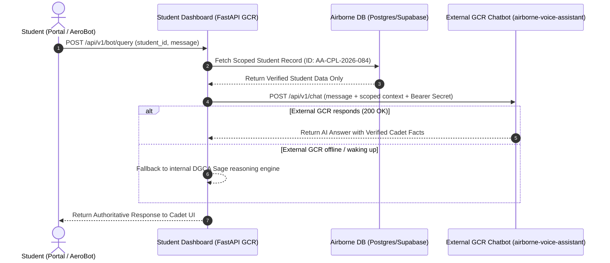

# Airborne Aviation Academy — GCR Deployment & Chatbot Integration Architecture

## 1. Overview
The **Airborne Aviation Student Dashboard** is packaged as a unified, production-grade container service tailored for **Google Cloud Run (GCR)** under project `airborne-aviation-505100` (`asia-south1`).

It serves:
1. **Frontend**: Vite + React Single Page Application (styled strictly according to the *Airborne Brand Book 2026*).
2. **Backend**: FastAPI running on Python 3.11 with dynamic `$PORT` binding.
3. **Airborne DB**: Houses students, attendance records, DGCA course modules, fee accounts, and class schedules with support for PostgreSQL (`DATABASE_URL` via Cloud Run Secret Manager) and local SQLite fallback.
4. **AeroBot GCR Gateway**: Securely bridges student chat queries with the external GCR Chatbot project (`airborne-voice-assistant`).

---

## 2. Strict Student Data Scoping & Access Control

> [!IMPORTANT]
> **Strict Access Policy**: The external GCR Chatbot service can **ONLY** access the records of the authenticated student. Cross-cadet leakage, bulk queries, and access to administrative/academy credentials are strictly prohibited.

### Scoped Context Endpoint
- **URL**: `GET /api/v1/bot/student-context/{student_id}`
- **Security**: Requires `Authorization: Bearer <INTERNAL_RAG_SHARED_SECRET>` or `X-Airborne-Shared-Secret: <API_SHARED_SECRET>`.
- **Row-Level Enforcement**: Queries only the records matching `StudentModel.id == student_id`.
- **Payload Returned to GCR Chatbot**:
  ```json
  {
    "authorized_student": {
      "id": "AA-CPL-2026-084",
      "name": "Cadet Ruzal Dhral",
      "computer_number": "C-09827341",
      "batch": "Batch Delta-26 (Dwarka Ground Classes)",
      "attendance_rate": "88.5%",
      "dgca_compliance_status": "COMPLIANT (Above 80% Rule)",
      "pending_fee": "INR 35,000",
      "fee_due_date": "15th November 2026",
      "target_dgca_session": "DGCA CPL Session 3/2026"
    },
    "today_schedule": [
      {
        "subject": "Air Navigation",
        "time": "08:30 AM - 10:30 AM",
        "topic": "Radio Navigation: VOR Radial Tracking",
        "instructor": "Capt. Navrang Singh",
        "location": "Dwarka Centre, Hall 2A",
        "status": "in-progress"
      }
    ],
    "enrolled_courses": [
      {
        "subject": "Air Navigation",
        "progress": "78%",
        "next_mock_exam": "04 Nov 2026"
      }
    ]
  }
  ```

---

## 3. AeroBot Gateway Query Flow


---

## 4. Google Cloud Run Deployment

### Option A: 1-Click Deployment Script
Run the included PowerShell or Bash script:
```powershell
.\deploy-cloudrun.ps1
```
or
```bash
./deploy-cloudrun.sh
```

### Option B: Manual `gcloud` Command
```bash
gcloud run deploy airborne-student-dashboard \
    --source . \
    --project airborne-aviation-505100 \
    --region asia-south1 \
    --platform managed \
    --allow-unauthenticated \
    --set-env-vars "GCP_PROJECT=airborne-aviation-505100,GCP_REGION=asia-south1,GCR_CHATBOT_SERVICE_URL=https://airborne-voice-assistant-368523757732.asia-south1.run.app" \
    --set-secrets "DATABASE_URL=DATABASE_URL:latest,INTERNAL_RAG_SHARED_SECRET=INTERNAL_RAG_SHARED_SECRET:latest,API_SHARED_SECRET=API_SHARED_SECRET:latest" \
    --memory 512Mi \
    --cpu 1
```
